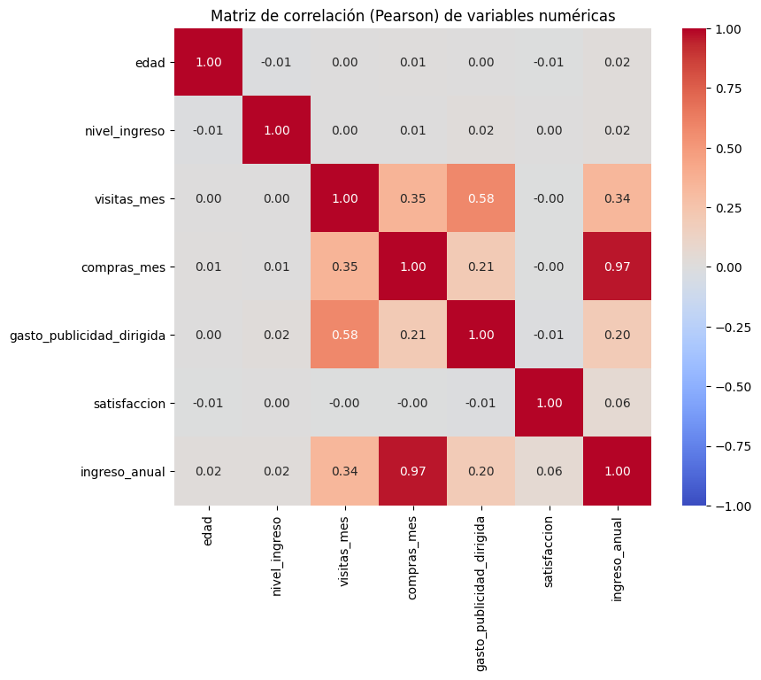
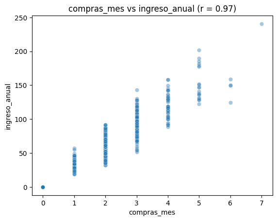
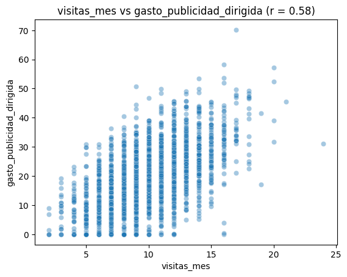

# NovaRetail+ Revenue Drivers: Correlation Analysis

**TripleTen Data Analyst Bootcamp project (2026) | Python · pandas · SciPy · Seaborn**

NovaRetail+ is an e-commerce platform in Latin America. This exploratory analysis of 15,000 customers answers one question for the Growth and Retention team: **which customer behaviors are most strongly associated with the annual revenue each customer generates?**

> This is a correlational analysis: it identifies associations, not causes.

## 🗂️ Data

15,000 customers and 12 columns with no missing values:

| Type | Columns |
| --- | --- |
| Numeric | age, estimated income, monthly visits, monthly purchases, targeted ad spend, satisfaction (1–5), annual revenue |
| Binary | premium membership, churn |
| Categorical | device type (mobile, desktop, tablet), region (north, south, east, west) |

## 🛠️ Methods

Each pair of variables was measured with the coefficient that fits its type:

| Method | Used for |
| --- | --- |
| Pearson and Spearman | Numeric vs numeric (linear and monotonic relationships) |
| Point-biserial | Binary vs numeric |
| Cramér's V | Categorical vs categorical |

Because 30.4 % of customers generated no revenue (exactly the customers with no purchases), annual revenue was grouped into four levels (no revenue, low, medium and high) to compare it with categorical variables.

  
  

## 💡 Key findings

1. **Purchases explain almost all revenue** (r = 0.97). Each additional purchase adds about 30 in revenue, so purchase frequency is the main growth lever.
2. **Visits and ads relate to revenue only indirectly.** Ad spend is associated with more visits (r = 0.58), but visits turn into purchases only moderately (r = 0.35), and many customers visit without buying. Since ads may be targeted at customers who already visit more, their real effect should be tested with an A/B experiment.
3. **Demographics and satisfaction barely matter.** Age (0.02), estimated income (0.02) and satisfaction (0.06) show almost no relationship with revenue, so segmenting by behavior is more useful than segmenting by profile.
4. **Premium customers generate 26 % more revenue** (44.6 vs 35.3 on average), even though the correlation is low (0.09) because only 14 % of customers are premium.
5. **Churn affects customers of every value level.** Customers who churned generated the same revenue as those who stayed (36.4 vs 36.6; r = −0.003).
6. **Device and region make no difference.** All Cramér's V values are below 0.02, and average revenue stays between 35.7 and 37.1 across devices and regions.

## ✅ Recommendations

- Focus growth strategies on converting non-buyers and increasing purchase frequency.
- Measure the real impact of targeted ads with an A/B test before increasing the budget.
- Explore a controlled test to promote premium membership.
- Apply retention actions to all customers, not only low-value ones.

## ⚠️ Limitations

- Correlation does not imply causation.
- Annual revenue is practically derived from purchases, so their near-perfect correlation does not explain why customers buy more.
- The data is a single snapshot from 2024 and lacks variables such as price, product category and active campaigns.

## 📁 Files

| File | Description |
| --- | --- |
| `novaretail_revenue_drivers.ipynb` | Full analysis with code, charts and conclusions (in Spanish) |
| `images/` | Charts used in this README |

The dataset was provided by the TripleTen platform and is not included in this repository.

## 🧰 Skills demonstrated

Python · pandas · SciPy · Pearson and Spearman correlation · point-biserial correlation · Cramér's V · data visualization with Seaborn · business interpretation of statistical results
